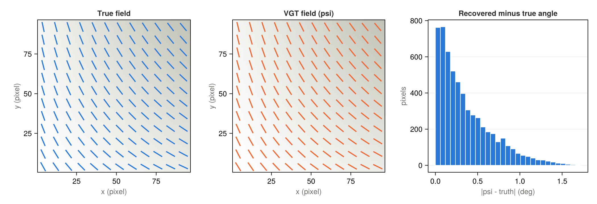

# VGT.jl

[](https://github.com/ISM-NU/VGT.jl/actions/workflows/test.yml)
[](LICENSE)

The Velocity Gradient Technique in Julia. VGT turns a spectral-line FITS cube
(H I or CO) into a map of the plane-of-sky magnetic-field orientation: velocity
gradients in thin channel maps, rotated by 90 degrees, averaged as Stokes-like
Q/U. This package is a parallel, chunked implementation with validated
estimators, noise models and sky-frame angle conversion, written for the Large
Magellanic Cloud sightline. The method is the Lazarian group's; where this code
comes from is in [`docs/provenance.md`](./docs/provenance.md).

## Quick start

```bash
git clone https://github.com/ISM-NU/VGT.jl.git && cd VGT.jl
julia --project=. -e 'using Pkg; Pkg.instantiate()'
julia --project=. examples/quickstart.jl
```

The example builds a small synthetic cube with a known, curved field, runs the
full pipeline and compares the result with the truth:



On your own cube: copy `config.example.toml` to `config.toml`, set
`input_file`, and run `julia --project=. main.jl` (details below).

```julia
using VGT
cfg = VGTConfig(input_file="cube.fits", output_dir="out", keep_intermediate_chunks=false,
                noise=0.16, dn=20, ker=4, ny_chunks=1, min_valid=100,
                fitter_mode=:axial_vonmises)
outputs = write_pipeline_outputs(run_pipeline(cfg))
```

VGT products (FITS, one run directory each):

- `psi_*.fits`: 2D VGT orientation proxy in radians
- `psi_reliability_*.fits`: smoothed Stokes coherence,
  `P = sqrt(Q^2 + U^2) / I`
- `psi_fit_rbar2_*.fits`: fitter-level coherence diagnostic
- `psi_support_*.fits`: fraction of velocity channels contributing successful
  local fits per sky pixel

By default all products sit on the input cube's pixel grid (same `CDELT`), but
their resolution is coarser: the `dn` window and the `ker` Gaussian (sigma, input
pixels), recorded in each header as `VGTDN`, `VGTKER`, `VGTKFWHM`. Set
`output_bin = b` to write them on a coarser grid instead: the smoothed Q/U/I are
averaged over `b` x `b` input pixels, psi and reliability are recomputed from those
averages, and the header WCS is scaled to match (`VGTBIN = b`). By default `psi` is
measured counter-clockwise from +FITS axis 1 of that grid (`PSIFRAME =
'PIXEL'`), not east of north; set `angle_frame = "galactic"` (or `"icrs"`) to
write it as an IAU position angle instead (`PSIFRAME = 'GALACTIC'`); on LMC-sized maps north rotates by tens of
degrees across the grid. Use `pixel_to_position_angle` (or
`scripts/foreground_stokes_from_vgt.jl --frame galactic` in the group's foreground repository) before comparing with
Planck or starlight, and regrid via Q/U (cos 2psi, sin 2psi), never psi itself.

For a beginner-oriented explanation of the workflow and physics, see
[`docs/EXPLAINER.md`](./docs/EXPLAINER.md). For the full documentation map, see
[`docs/README.md`](./docs/README.md); for dependency guidance,
[`docs/dependency-guidance.md`](./docs/dependency-guidance.md).

## Requirements

Group members usually work from the LMC workspace (the private ISM-NU/LMC-workspace repository), whose `setup.sh` clones the related repositories side by side and links the shared `lmc-data` folder.

- Julia 1.10 or newer
- FITS cubes under `data/exp_raw/` (not in git; shared through the team Google
  Drive). The ones used here:
  - `Tb_combined_LMC_182_339_res1_3pperb_reprojected_on_gass_masked.fits`: LMC
    H I, 2174 × 2174 pixels of 20″ (1′ resolution), 159 channels, 182-340 km/s
  - `Tb_combined_mw_full_hnv_resOG_reprojected_on_gass.fits`: Milky Way
    foreground H I at original resolution, 3624 × 3624 pixels of 12″, 106
    channels, −54 to +51 km/s, same sky area
  - `lmc_v11.co.vradlsr.{base,rms}.fits`: MAGMA CO cube and its noise

## Repository Files

- `main.jl`: VGT entry point, `julia main.jl [config.toml]`
- `examples/quickstart.jl`: synthetic end-to-end example (figure in `docs/images/`)
- `config.example.toml`: VGT config template
- `src/`: package code
  - `src/science/`: VGT kernels, fitters, noise models, `psi` products
  - `src/pipeline/`: run orchestration, chunk stitching, output writing
  - `src/config.jl`, `src/fits_io.jl`, `src/paths.jl`: configuration, FITS wrappers, output paths
- `hpc/irgetas/`: Slurm script for the NU Irgetas cluster
  ([runbook](./hpc/irgetas/README.md))
- `scripts/`: validation, profiling and cube-preparation utilities
  ([catalog](./scripts/README.md))
- `test/`: unit and smoke tests
- `docs/`: method notes and validation records ([map](./docs/README.md))
- `data/exp_raw/`: input cubes (ignored by git); `data/sims/`, `validation_output/`:
  run outputs (ignored)

## Related repositories

All in the ISM-NU organisation:

- [ROHSA-LMC](https://github.com/ISM-NU/ROHSA-LMC) (public): ROHSA Gaussian decomposition and velocity-layer cubes.
- `ISM-NU/LMC-foreground` (private until publication): Milky Way foreground, Planck 353 GHz and starlight
  comparisons with VGT maps.
- `ISM-NU/LMC-cold-gas` (private until publication): cold H I experiments and ROHSA run configs.
- [LMC-shells](https://github.com/ISM-NU/LMC-shells) (public): optical supergiant-shell analysis.

The experiment repositories pin this one as a git submodule under `deps/`. The
shared data folder is `lmc-data` next to the repositories; in each repository `data/` is a
symlink to it, created from the repository root with

```bash
ln -s ../lmc-data data
```

## First-Time Setup

From the repository root:

```bash
julia --project=. -e 'using Pkg; Pkg.instantiate(); Pkg.precompile()'
```

This installs the exact dependency set recorded in `Manifest.toml`. The active
helper stack includes `DrWatson.jl` for parameter-named run directories,
`AstroFITS.jl` plus `FITSIO.jl` for FITS I/O, `WCS.jl` for coordinate metadata,
and `BenchmarkTools.jl` for reproducible performance checks.

The repository includes a `.envrc` for `direnv` users:

```bash
direnv allow
```

It sets `JULIA_PROJECT=@.` so Julia uses this project from the repository or any
subdirectory, and defaults `JULIA_NUM_THREADS` to `16`. Override the thread count
per command when needed, for example `JULIA_NUM_THREADS=4 julia test/runtests.jl`.

Create a local config before running on a new checkout:

```bash
cp config.example.toml config.toml
```

Then put raw FITS cubes under `data/exp_raw/`, set `input_file`, `noise`, and any
execution overrides for the cube you are processing.

## Run

Run the pipeline from the repository root:

```bash
julia main.jl            # uses config.toml
julia main.jl other.toml # any other config
```

With the checked-in `.envrc`, this uses the local project environment and runs
with 16 Julia threads by default.

Run the test suite:

```bash
julia test/runtests.jl
```

## Configuration

Runtime parameters live in `config.toml`. `config.example.toml` is the template for new datasets.

- `input_file`: FITS cube path
- `output_dir`: output directory for chunk files and final products. If left as
  `subcube` or set to `""`, the package writes to a DrWatson path under
  `data/sims/vgt/<parameter-name>/`.
- `keep_intermediate_chunks`: retain or delete `chunk_2d_*.jld2` after a successful run
- `noise`, `noise_mode`, `noise_tile_size`, `noise_sigma_multiplier`: threshold model for the VGT mask
- `dn`, `ker`, `min_valid`: VGT window, smoothing, and minimum-valid-pixel parameters
- `fitter_mode`: `"axial_vonmises"` (the only fitter)
- `zero_stokes_policy`: whether zero Q/U support is converted to `NaN` before smoothing
- `output_support_mode`: `"smoothed_stokes_support"` keeps the smoothed Q/U halo; `"direct_fit_support"` blanks pixels without direct fitted-window support
- `gradient_mode`: `"central_checked"` by default; `"sobel_checked"` and `"nan_edge_backward"` (backward differences) for comparisons
- `rbar2_weight`, `rbar2_gate`: optional per-channel coherence weighting/gating; keep disabled unless a component-matched validation supports enabling them
- `ny_chunks`: execution control; use `"auto"` to derive chunking from the current Julia thread count and cube geometry. Thread count is controlled when launching Julia with `--threads=N` or `JULIA_NUM_THREADS`.

The package reads config through a typed `VGTConfig` instead of relying on script globals.

The production fitter default is `:axial_vonmises`; the production gradient
default is `:central_checked`, adopted after synthetic validation showed much
lower angular error without the coverage loss from larger windows. The
backward-difference path is kept for comparisons. The Gaussian-histogram fitter,
the legacy-matching modes and `separable_shrinkage` noise were removed in 0.1.0
after validation found them worse than the defaults (see
[`docs/provenance.md`](./docs/provenance.md)); config files that still set them
are rejected with an explanatory error. The
implementation is in `src/science/fitters.jl` and `src/science/vgt.jl`.
Do not change fitter defaults, masks, interpolation, or numerical shortcuts
without validation evidence.

To estimate `noise` before a run:

```bash
julia scripts/analyze_inputs.jl path/to/cube.fits
```

If you omit the FITS path, the script analyzes its built-in default file list.
Use the reported `Suggested config: noise = ...` value in `config.toml`. The
script prefers robust negative-pixel noise; if the cube has no negative samples,
it reports a clearly labeled line-free/blank-region fallback and warns that an
unclipped calibrated cube is preferable. The script also reports channel and
spatial Noise spread, then tells you whether a single scalar `noise` is still
appropriate or whether a dynamic threshold should be investigated. Keep
`noise_mode = "scalar"` unless validation evidence supports `"channel"`,
`"spatial"`, `"separable"`, or `"auto"` for the specific cube.

To choose `dn` and `min_valid`, run a parameter scan on the target cube and
configuration family:

```bash
julia scripts/validate_vgt_parameters.jl \
  --input path/to/cube.fits \
  --noise 0.16 \
  --fitter axial_vonmises \
  --dn 10,14,20,28 \
  --min-valid auto \
  --rbar2-mode baseline,weight,gate0.50 \
  --output-dir data/sims/vgt_parameter_scan
```

The scan reruns the pipeline for each candidate, compares adjacent window sizes
with axial residuals, and writes `summary.txt`, `summary.csv`, and
`pairwise_residuals.csv`. Treat its recommendation as an internal-stability
gate for the cube, not as external astrophysical validation. `--min-valid auto`
expands to fractional valid-pixel thresholds and reports a recommendation; it
does not silently change production config.

## Validation And Analysis Commands

Run bounded synthetic sweeps:

```bash
julia scripts/validate_synthetic.jl
```

Profile a representative crop:

```bash
julia scripts/profile_pipeline.jl
```

For the complete script catalog, see [`scripts/README.md`](./scripts/README.md).

## Validation Reports

Durable validation conclusions belong in `docs/`. Local generated runs and
reports belong under ignored `data/sims/...` directories by default. Comparisons
with external tracers (starlight, Planck) are in the group's foreground repository (private until publication); they are
comparison tracers, not ground truth.

Validation, profiling, and comparison scripts that compute scalar metrics also
write compact DrWatson-tagged records under `<output-dir>/summaries/` and a
`collected_results.jld2` aggregate. These files are for quick cross-run
screening; use the FITS products and text/CSV reports for the full science
context.

## Output

The pipeline writes parameter-named run directories under `data/sims/vgt/` by
default. Each run contains:

- `chunk_2d_*.jld2`: intermediate per-chunk results
- `psi_<input-stem>.fits`: final angle map
- `psi_reliability_<input-stem>.fits`: reliability map
- `psi_fit_rbar2_<input-stem>.fits`: doubled-angle resultant coherence
- `psi_support_<input-stem>.fits`: fraction of velocity channels contributing
  successful local fits per sky pixel
- `psi_plot_<input-stem>.png`: quick-look image of the result
- `run_metadata.toml`: run configuration, diagnostics, product paths, and
  DrWatson git provenance for the output bundle

If a final output file already exists, the pipeline now preserves it and writes the
new run to a suffixed filename such as `psi_CO_data_reproject_1.fits`.

## Notes

- The package resolves `ny_chunks` at runtime when it is set to `"auto"`.
- `run_metadata.toml` records execution facts such as the Julia thread count, resolved chunk count, and elapsed pipeline time.
- The checked-in `.envrc` defaults `JULIA_NUM_THREADS` to `16`; override it per command, for example `JULIA_NUM_THREADS=8 julia main.jl`.
- Chunks are processed one after another to cap memory use; the VGT window fits inside each chunk use Julia threads.
- Large FITS cubes can require substantial RAM, disk I/O, and runtime.
- Chunk files now record fit-attempt diagnostics, so numerical failures are observable after a run.
- If package loading fails on a fresh machine, re-run:

```bash
julia --project=. -e 'using Pkg; Pkg.resolve(); Pkg.instantiate(); Pkg.precompile()'
```
